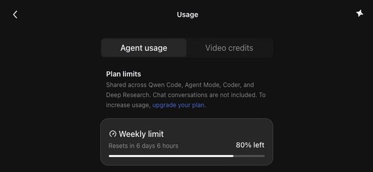

# Qwen Usage for bb

Adds Qwen Plus/Pro weekly consumption to bb's existing **Provider usage** panel.
The Qwen Code provider remains responsible for model access; this plugin only reads quota.
This is an unofficial community plugin, not affiliated with Qwen or bb.

> Experimental, macOS Apple silicon only. Tested with bb 0.50.1. It depends on
> Qwen's visible website layout and requires a separate web login inside bb.

## What you get

- Qwen subscription consumption alongside the other providers in bb.
- The same weekly Agent Usage shown by Qwen, expressed as **used**, rather than remaining.
- A manual refresh command for checking the current measurement.
- Clear unavailable/stale states when the browser session or website cannot be read.
- No API key setup, imported cookies, or background prompts that spend your model quota.

### The quota source, inside bb



Real screenshot from bb's built-in browser. Here Qwen reports **80% left**;
the plugin maps that to **20% used** in bb's Provider usage panel.
This is subscription consumption, not API billing or token-by-token accounting.

## Setup

Requires macOS, bb desktop 0.50.1 or newer, its CLI at `/opt/homebrew/bin/bb`,
and a working `acp-qwen-code` provider. This first version supports one connected machine.

```sh
bb plugin install git:https://github.com/mrosminin/bb-qwen-usage.git
bb qwen-usage connect --thread YOUR_THREAD_ID
```

Sign in yourself in the dedicated Qwen tab opened inside bb. This is separate
from Qwen Code's OAuth login. Keep the tab available for quota collection.
Then open Provider usage or run:

```sh
bb qwen-usage status --refresh --json
```

`connect` opens the owning thread and reveals the same tab, or creates a replacement if it was closed.
The first connection needs an existing bb thread ID; subsequent calls may omit it.
Do not use the quota tab for ordinary chats.
Create or choose a visible bb thread before connecting. Use `bb thread list --json`
to find its ID; no model prompt needs to be sent for quota collection.

## Collection and limits

- Reads only visible Agent Usage at `https://chat.qwen.ai/settings/usage-billing`.
- The website handles sign-in and session renewal. Cookies and authentication tokens
  are never extracted or imported from other applications.
- Uses a short bb browser lease for its own tab. Releases it and removes the private
  temporary connection descriptor after collection, including failures.
- Reloads the page before a measurement and waits for a new document. In narrow
  layouts Qwen returns to Settings; the collector follows only its visible Usage link.
  It caches results for 60 seconds and shares concurrent requests. No background polling or model calls.
- Converts remaining percentage to consumption: 75% remaining means 25% used.
- Closed tab, expired login, changed markup or timeout returns unavailable, with the
  last successful observation time. An old percentage is not returned as fresh.
- Exact reset time and account identity are unknown and remain null. A relative
  reset label is included in CLI output when the visible page exposes one.
- Requires running bb desktop and a supported website layout. Long-term session renewal
  must be verified in actual use; the plugin does not bypass login challenges.

Only the non-secret owner host/thread/tab IDs are persisted in plugin-scoped bb storage.
Disabling the plugin stops collection; it does not sign out of Qwen or change providers.
Like other bb plugins, it runs as trusted local code. Review the source before installing.
The current version deliberately requires one connected machine and one desktop browser instance.
bb's panel may retain its own older snapshot with a warning when collection fails;
`bb qwen-usage status --refresh --json` reports the latest collection attempt directly.

To disable collection without removing the code:

```sh
bb plugin disable qwen-usage
```

To update a Git-installed copy:

```sh
bb plugin update qwen-usage
```

## Troubleshooting

| What you see | What to do |
| --- | --- |
| Qwen works in chat but quota is unavailable | Sign in separately in the plugin's bb browser tab. Qwen Code OAuth does not sign in that tab. |
| The quota tab was closed | Run `bb qwen-usage connect` to reveal or recreate it. |
| An old number remains in the panel | Read the warning and observation time; use `bb qwen-usage status --refresh --json` to check the latest attempt. |
| The page is signed in, but collection fails | Check that Agent Usage is visible. The site's markup may have changed; report the error with secrets removed. |
| Reset time is missing | Expected: the site exposes a relative label, not a reliable exact timestamp. |

## Development

```sh
npm install
npm test
npm run typecheck
bb plugin build .
```

Use Node.js 24 or newer for the TypeScript test runner and the bb CLI matching your
running desktop app. For a local checkout, install with `bb plugin install .`.

The initial release has 18 automated tests for quota parsing, caching, concurrent
reads, browser scope and document freshness. A real Qwen login, page reload,
quota read and bb Provider usage display were verified on macOS. Session renewal
after actual expiry, other operating systems and multiple machines are not verified.

`server.ts` registers the provider-usage RPC source and `qwen-usage` CLI.
`src/browser.ts` owns the scoped browser connection and freshness checks;
`src/snapshot.ts` reads quota DOM. Parser, cache and panel mapping are separate modules.

## License and attribution

MIT — see [LICENSE](LICENSE).
The provider-usage.v1 integration follows the public bb plugin SDK and the MIT-licensed
[bb-kimi-code](https://github.com/dpolishuk/bb-kimi-code) contract. See [NOTICE](NOTICE).
